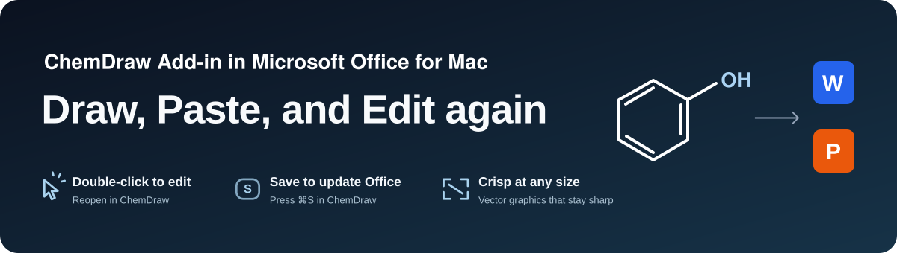

# ChemDraw Add-in for Mac

[Download v1.2.0 installer](https://github.com/BoeingART/chemdraw-add-in-for-mac/releases/tag/v1.2.0) · [Installation guide](docs/installation.md) · [中文安装指南](docs/quickstart-zh.txt)

ChemDraw Add-in for Mac connects ChemDraw with Microsoft Office. Copy a chemical structure, paste an editable drawing, double-click to edit it in ChemDraw, and save to return changes to the original document. Drawings carry their editable source and ChemDraw's native SVG file.

## Install and configure

Requires **macOS 12 or later**, **ChemDraw** and **Word and/or PowerPoint for Mac**, installed and activated separately. The installer includes Apple Silicon and Intel executables. 

1. Finish any active ChemDraw edit and quit the helper before installing or upgrading. Open **ChemDraw-Add-in-for-Mac-1.2.0-universal.pkg**. If macOS blocks opening it, use **System Settings → Privacy & Security → Open Anyway**.
2. The installer opens **设置加载项** with four checks: Word file access, PowerPoint file access, Accessibility and paste-helper readiness. Grant the requested system permissions; setup continues automatically. Choose **完成** after all checks pass.
3. The app runs in the menu bar with a transparent C outline. Its menu shows the version, **检查更新**, **打开界面**, **隐藏图标** and **退出应用**.
4. Choose **打开界面** to access **设置加载项**, **检查更新**, **修复加载项**, **退出应用** and the **设置为开机启动项** checkbox. Update checks use this repository's latest stable GitHub Release. Reopen the app from Applications to restore a hidden icon.

## Paste and edit

1. Open a new or existing Word document or PowerPoint presentation.
2. Select a structure in ChemDraw and copy it with **⌘C**.
3. Paste in Office with **⌘V**, right-click **Paste**, or the panel's **Paste editable drawing** button.
4. Double-click the drawing to edit it in ChemDraw. Press **⌘W** to update the original Office drawing and return.
5. Save the Office document when you choose. New, unsaved documents support direct paste, opening and write-back.

Pasting during an existing edit creates an independent figure while the original edit retains its Office document and ChemDraw target. Document identities keep write-back attached to its target through Save As and window switches. The panel and configuration window display operation failures and the next action.

Choose **退出应用** in the configuration window, or press **⌘Q**, when finished. Open the app again for the next session.

## Local data and recovery

Certificates, captured structures and editing drafts remain in `~/Library/Application Support/ChemOffice/work` across upgrades and the application rename. Use **本机数据** to open this folder. Each Office host exchanges previews through its own sandbox cache.

An interrupted edit retains its ChemDraw draft. Double-click the original drawing to resume. Closed drafts are retained under `recovery` when starting another edit. Keep the original Office document open while editing and use **⌘W** to return changes. Flattening a drawing into a screenshot removes its editable source.

The helper handles chemical clipboard data during explicit paste operations. Editing runs locally. The optional task pane connects to a loopback HTTPS service; its Office.js library loads from Microsoft's CDN.

## Build and validation

Source builds require Apple's command-line tools with Swift 5.7 or later.
See [installation readiness](docs/installation-readiness-results.md) and [unsaved Office document checks](docs/unsaved-office-results.md). Saved practice documents are in [examples](examples/README.md).

Copyright 2026 ChemDraw Add-in for Mac contributors. Released under the [Apache License, Version 2.0](LICENSE).
