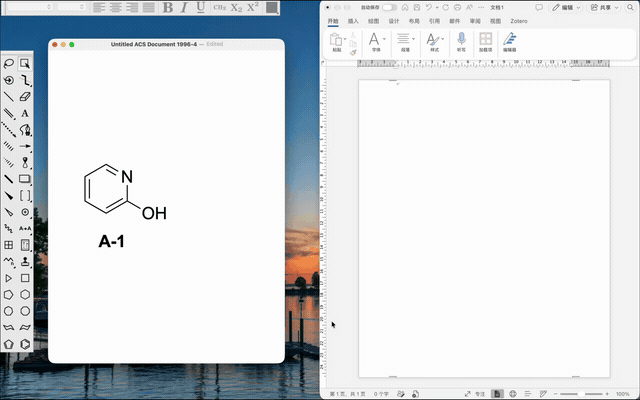

# Edit ChemDraw structures in Word, PowerPoint and Excel for Mac

[简体中文](editable-chemdraw-office-mac_CN.md) · [Project](../README.md) · [Download the installer](https://github.com/BoeingART/chemdraw-add-in-for-mac/releases/latest)

ChemDraw Add-in for Mac lets you paste a chemical structure into Microsoft Word, PowerPoint or Excel, double-click the drawing to edit it in ChemDraw, and save changes back to the original Office image.

## Before you start

Install and activate ChemDraw and Office for Mac. The add-in requires macOS 12 or later and configures the Office apps installed on your Mac.

Download the universal DMG from [Releases](https://github.com/BoeingART/chemdraw-add-in-for-mac/releases/latest), move the app to Applications, then open it. In Add-in Setup, confirm the requested Office file-access, Accessibility and Automation permissions. Setup checks directory writing and read-back and starts the helper automatically. See the [installation guide](installation.md) for the complete setup steps.

## Paste an editable structure

1. Open a Word document, PowerPoint presentation or Excel workbook. A new, unsaved document works too.
2. In ChemDraw, select a structure and copy it with **⌘C**.
3. In Office, use **⌘V**, right-click **Paste**, or the panel's **Paste editable drawing** button.
4. Double-click the inserted drawing to reopen its chemical source in ChemDraw.
5. Make a change and press **⌘S**, or choose **Save**. The original Office image updates and the ChemDraw editor stays open.
6. Close the ChemDraw editing document to return to Office. Save the Office document when you choose.

Each drawing carries its editable source and vector artwork. Pasting another structure during an edit creates an independent drawing. The existing edit retains its original Office target.

## When a structure is already in a document

The published **1.5.7** workflow edits drawings pasted through this add-in. For an existing document, start with editable chemical source in ChemDraw and paste it through the add-in to create a managed drawing.

Work on opening and updating existing **Windows ChemDraw OLE objects** is tracked on the [2.0 development branch](https://github.com/BoeingART/chemdraw-add-in-for-mac/tree/dev-2.0). Check that branch's current host support and validation records when evaluating Windows-created documents.

For a standalone PNG, screenshot or other image, obtain or recreate the editable structure in ChemDraw before using the paste workflow.

## If pasting or editing stops

Open the add-in panel or setup window to see the failed step and the suggested action. Use **Repair Add-in** when Office access or panel configuration needs attention. When enabling another installed Office app, complete that app's initial permission prompts.

For help, [open a GitHub issue](https://github.com/BoeingART/chemdraw-add-in-for-mac/issues/new) with your macOS, ChemDraw, Office and add-in versions, the Office app involved, the steps you followed and the exact error text. Include a small example structure that you can share.
