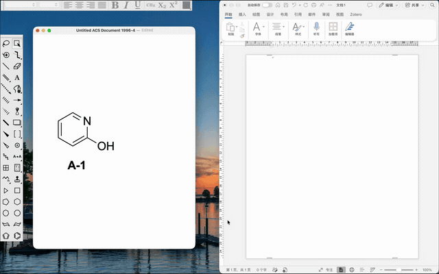

# Mac 上的 ChemDraw 结构如何粘贴到 Word、PPT、Excel 并继续编辑

[English](editable-chemdraw-office-mac.md) · [项目介绍](../README_CN.md) · [下载安装包](https://github.com/BoeingART/chemdraw-add-in-for-mac/releases/latest)

ChemDraw Add-in for Mac 支持将化学结构粘贴到 Mac 版 Word、PowerPoint 或 Excel，双击绘图即可回到 ChemDraw 编辑。修改后按 ⌘S，原 Office 图片会同步更新，ChemDraw 编辑窗口保持打开。

## 使用前准备

需要 macOS 12 或更高版本，以及已安装并激活的 ChemDraw 和 Office for Mac。程序按本机已安装的 Office 应用配置加载项。

从 [GitHub Releases](https://github.com/BoeingART/chemdraw-add-in-for-mac/releases/latest) 下载通用 DMG，将应用拖到“应用程序”文件夹后打开。在“设置加载项”中，按系统提示确认 Office 文件访问、辅助功能和自动化权限。程序会检查目录写入与读回，并自动启动助手。完整步骤见[安装指南](installation.md)。

## 从复制到双击编辑

1. 打开 Word 文档、PowerPoint 演示文稿或 Excel 工作簿，新建且尚未保存的文档也可以直接使用。
2. 在 ChemDraw 中选中结构，按 **⌘C** 复制。
3. 在 Office 中按 **⌘V**、右键选择“**粘贴**”，或点击面板中的“**粘贴可编辑绘图**”按钮。
4. 双击插入的绘图，在 ChemDraw 中打开结构源数据。
5. 修改后按 **⌘S** 或选择菜单“**保存**”，原 Office 图片随即更新，编辑窗口保持打开。
6. 关闭该 ChemDraw 编辑文档，返回 Office。由你决定何时保存 Office 文档。

每个绘图都携带可编辑的结构源数据和矢量图形。编辑期间再次粘贴，会创建独立绘图，原来的编辑仍对应原 Office 目标。

## 已有文档中的结构怎么处理

已发布的 **1.5.7** 版本编辑通过本加载项粘贴的绘图。处理已有文档时，可以先在 ChemDraw 中取得可编辑结构，再通过加载项粘贴，生成可双击编辑的绘图。

读取和回写已有的 **Windows ChemDraw OLE 对象**正在 [2.0 开发分支](https://github.com/BoeingART/chemdraw-add-in-for-mac/tree/dev-2.0)推进。使用 Windows 创建的文档前，可查看该分支当前支持的 Office 应用及验证记录。

只有 PNG、截图等图像文件时，先取得或在 ChemDraw 中重建可编辑结构，再使用上述粘贴流程。

## 遇到粘贴或打开失败

打开加载项面板或设置窗口，查看具体失败步骤及下一步操作。Office 文件访问或面板配置需要处理时，选择“修复加载项”。首次启用另一款已安装的 Office 应用时，完成该应用的授权提示。

需要反馈时，请在 [GitHub Issues](https://github.com/BoeingART/chemdraw-add-in-for-mac/issues/new)中提供 macOS、ChemDraw、Office 和加载项版本，注明使用的 Office 应用，写清操作步骤和完整错误文字，并附上可以公开的小型结构样例。
